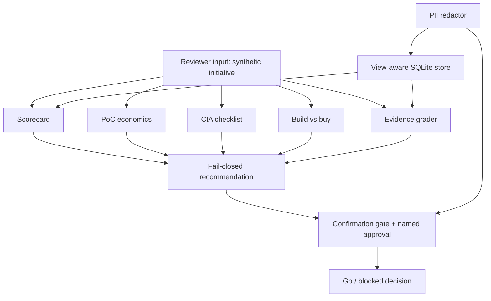

# Finance Governance PoC

**AI governance and responsible proof-of-concept design for finance —
a framework for evaluating AI initiatives before deployment.**

> All data in this repo is **synthetic**. The firm in every example,
> **Fernwick Bank**, is invented and is not a real business. No
> affiliation with any university, training provider, vendor, or real
> bank is claimed anywhere in this repo. No deployment, package
> release, or workflow badge is claimed, because none exists.

## Recruiter summary

- Problem: finance teams are offered AI tools faster than they can
  judge them, so weak, costly, or unauditable ideas can reach deployment.
- Approach: a small offline toolkit that scores an idea on three
  pillars, prices its model calls, reviews its security checklist,
  weighs building against buying, and grades its evidence — all before
  anyone approves a launch.
- Proof: **72 tests, all passing** on system Python with no
  third-party packages (run: `python3 -m pytest tests -q` from this
  directory; summary line in [How to run](#how-to-run)). Every number
  in this README comes from an actual run of this code, with sample
  sizes stated where they matter: the suite is 72 self-written
  regression checks, not a quality claim about a production system.

## Purpose and who it is for

For risk reviewers, finance managers, and engineers who must say no
with reasons. The toolkit answers one question: should this AI idea go
further, and what is missing before it may? Full text:
[docs/purpose.md](docs/purpose.md).

It covers five jobs:

1. **Governance scorecard** — danger, clarity of reasoning, and
   record-keeping per initiative, with a fail-closed rule: any pillar
   below 60 blocks a deploy recommendation.
2. **PoC economics** — model-choice cost comparison and
   inference-cost estimation, with a budget gate that rejects
   negative inputs.
3. **CIA-triad security review** — secrecy, correctness, and uptime
   as a scored checklist; overall pass needs every leg fully met.
4. **Build-vs-buy framework** — weighted criteria with a worked
   synthetic example; weights are normalised and ties return
   `evaluate_further`.
5. **Live / trial / idea-stage evaluation** — evidence-graded
   classification, so a claim is checked against the evidence its
   grade requires.

## Architecture



Module map: `finance_governance/scorecard.py`, `economics.py`,
`cia.py`, `build_buy.py`, `evidence.py`, plus cross-cutting
`approvals.py`, `gates.py`, `pii.py`, `store.py`, `notify.py`,
`brand.py`. See [docs/architecture.md](docs/architecture.md).

## How it works, step by step

1. Describe the idea: name, three pillar scores (0–100), a grade
   claim, and the evidence actually held.
2. Score it: `score_initiative` returns the mean, weakest pillar, and
   recommendation; any pillar below 60 gives `blocked`.
3. Price it: `estimate_inference_cost` on token counts and query
   counts; `compare_models` sorts cheapest first; `budget_gate`
   checks the budget. Negative inputs raise.
4. Review security: `cia_review` over `CIAItem` rows; pass needs
   every leg fully met.
5. Weigh build vs buy: `build_vs_buy` over weighted criteria.
6. Grade evidence: `classify_initiative` awards the highest grade
   whose evidence set is fully present and lists what is missing
   for the claimed grade.
7. Gate the decision: `ConfirmationGate` approves only a clear,
   confident yes; `Approval` is named-person, single-use, scoped,
   and expiring; `require_approved_gate` refuses every other path.
8. Read data safely: one view, `v_initiative_scorecard`; direct
   base-table reads, system-table reads, writes, and schema changes
   are denied by the authorizer; fetches are capped.
9. Report cleanly: `redact_text` removes card numbers, email
   addresses, phone numbers, and SSNs before output.

Full walkthrough: [docs/how-it-works.md](docs/how-it-works.md).

## Real code excerpts and their real output

```python
# scorecard.py — fail-closed, no averaging escape hatch
@property
def recommendation(self):
    return "blocked" if self.blocked_pillars else "deploy_candidate"
```

```python
# gates.py — the only way through is an approved gate object
def require_approved_gate(result, action=""):
    if not isinstance(result, GateResult) or not result.approved:
        raise PermissionError(f"gate not approved; action {action!r} refused")
    return True
```

Real output — `PYTHONPATH=. python3 -m finance_governance.demo`:

```
scorecard invoice-helper mean=81.67 recommendation=deploy_candidate
scorecard memo-drafter weakest=risk blocked=['risk'] recommendation=blocked
cost comparison (1000 in / 500 out x 10): [{'model': 'small', 'estimate': 0.02}, {'model': 'large', 'estimate': 0.25}]
budget gate 0.20 vs 100.0: True
CIA overall_pass=False failed_legs=['availability']
build-vs-buy: build
evidence: {'name': 'risk-watcher', 'claimed_grade': 'production', 'awarded_grade': 'production', 'claim_supported': True, 'missing_for_claim': []}
redacted: contact [REDACTED:EMAIL] or card [REDACTED:CARD]
```

More excerpts: [docs/code-excerpts.md](docs/code-excerpts.md).

## How to run (offline first)

Requirements: Python 3.10+, system `pytest`. Standard library only.
No network, no accounts, no keys, no virtual environment inside this
directory.

```bash
cd Jagadish-finance-governance-poc
python3 -m pytest tests -q
PYTHONPATH=. python3 -m finance_governance.demo
```

Verified suite result (system `python3 -m pytest`, run from the
scaffold directory):

```
72 passed in 0.10s
```

There is no cloud step: this scaffold is offline by design.
See [docs/how-to-run.md](docs/how-to-run.md).

## Guardrails and security controls

- Strict view-aware SQLite authorizer from the start: base-table
  reads allowed only when the authorizer's source names an allowed
  view; `sqlite_master`, writes, PRAGMA, ATTACH, and extension
  loading denied. Authorizer tests assert denial by exception type
  only (text check disabled).
- Every confirmation gate tested on bypass, reject, absent,
  low-confidence, and self-contradicting-consent ("yes, wait, no")
  paths, not just the happy path.
- Approvals: named person, single use, scoped, expiring.
- PII redaction checklist covers **card numbers and email
  addresses** as well as phone numbers and SSNs.
- Row cap at fetch time via `fetchmany(MAX+1)` — no LIMIT rewriting,
  no `fetchall` in the helper; over-cap raises.
- Cost/budget inputs reject negatives before any arithmetic.
- Brand blocklist stored as hashes and asserted non-empty in tests.
- Email channel is `dry_run=True` by default, needs explicit opt-in
  to send, is refused in CI, and stores no credentials.

Named proof tests for every claim:
[docs/guardrails.md](docs/guardrails.md).

## Limitations and known failures

Scores are reviewer judgements, not measurements; cost estimates are
only as good as caller-supplied prices; the evidence grader checks
that named items are listed, not that underlying documents are real;
and the email channel never delivers mail in this scaffold, even with
opt-in. Known failure kept visible as a test: over-cap fetches raise
`RowCapExceeded` instead of silently paging. Full list:
[docs/limitations.md](docs/limitations.md).

## Built / Written-not-run / Planned

| Item | Status |
| --- | --- |
| Governance scorecard (fail-closed), PoC economics, CIA checklist, build-vs-buy, evidence grading | Built |
| Gates, approvals, authorizer, PII redaction, row cap, email dry-run, brand blocklist | Built |
| 72-test suite, green on system pytest | Built |
| Partial-credit CIA scoring, evidence document verification, web UI/API | Planned, not built |
| Deployment, PyPI release, badges | Planned, not built — no claim made |

Nothing in this table is marked Built without a passing test behind
it. Detail: [docs/built-vs-planned.md](docs/built-vs-planned.md).

## Docs

- [docs/recruiter-summary.md](docs/recruiter-summary.md) — recruiter summary
- [docs/purpose.md](docs/purpose.md) — purpose
- [docs/architecture.md](docs/architecture.md) — architecture (Mermaid)
- [docs/how-it-works.md](docs/how-it-works.md) — step by step
- [docs/code-excerpts.md](docs/code-excerpts.md) — real excerpts + real output
- [docs/how-to-run.md](docs/how-to-run.md) — run offline first
- [docs/guardrails.md](docs/guardrails.md) — guardrails + proof tests
- [docs/limitations.md](docs/limitations.md) — limitations + known failures
- [docs/built-vs-planned.md](docs/built-vs-planned.md) — honest status
- [docs/implementation-guide.md](docs/implementation-guide.md) — adopter guide
- [docs/interview-points.md](docs/interview-points.md) — interview points
- [docs/threat-model.md](docs/threat-model.md) — threat model + ADRs
- [docs/related-repos.md](docs/related-repos.md) — related repos, cross-links

## Knowledge folder

Distilled notes in the repo's own words, plus separate Mermaid
architecture docs, linked here (not copied source material):

- [knowledge/notes.md](knowledge/notes.md) — distilled patterns
- [knowledge/architecture.md](knowledge/architecture.md) — architecture (Mermaid)
- [knowledge/evidence-grades.md](knowledge/evidence-grades.md) — evidence grades
- [knowledge/governance-patterns.md](knowledge/governance-patterns.md) — governance patterns

Source note: patterns were distilled in the author's own words from
a published finance AI programme brochure. An 8-word overlap check
of all repo docs and code against the brochure text returns 0 hits
(see `scripts/overlap_check.py`); the brochure itself is not included
in this repo.

## Licence and security

MIT — see [LICENSE](LICENSE). Security policy:
[SECURITY.md](SECURITY.md).
