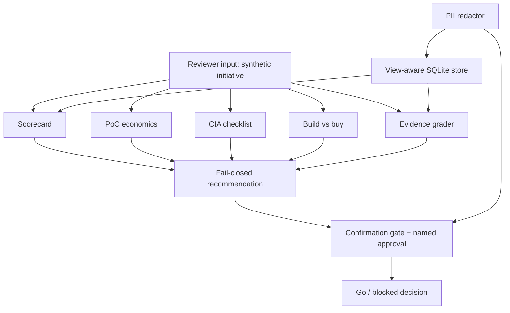

# Architecture

Modules map one-to-one to the five jobs: `scorecard`, `economics`,
`cia`, `build_buy`, `evidence`. Cross-cutting controls live in
`approvals`, `gates`, `pii`, `store`, `notify`, and `brand`.
Nothing calls the network. Storage is an in-memory database behind a
view-only authorizer.
